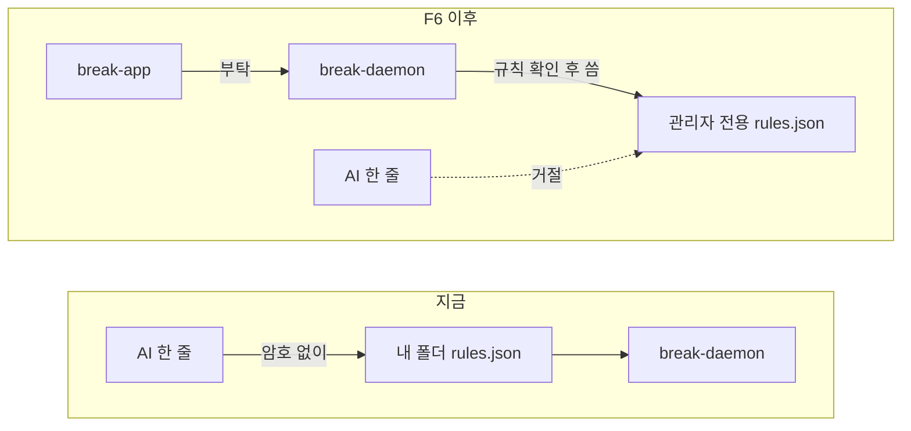
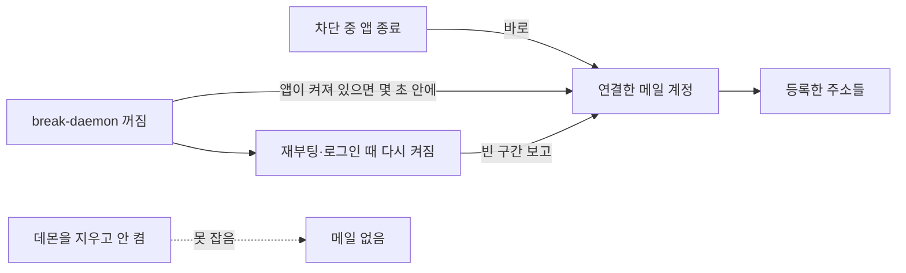
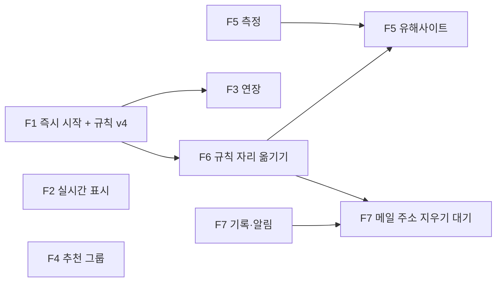

# Break macOS 필수 기능 PRD

작성: 2026-10-18
근거: 그릴링 5라운드(2026-10-17~18), `docs/roadmap.md`의 A1~A5·B1·B2
구현 상태: `docs/mac-essentials/status.md`

## 왜 하는가

Break는 지금 정해 둔 요일과 시각에 사이트를 막는다. 막는 것 자체는 Safari, Chrome, Aside에서
확인됐다. 하지만 쓰는 사람 입장에서는 세 가지가 모자라다.

- **바로 막을 수 없다.** "지금부터 두 시간"을 하려고 반복 일정을 만드는 절차를 밟아야 한다
- **돌고 있는지 안 보인다.** 남은 시간은 1분에 한 번 바뀌고, 현재 시각 표시는 눈금과 구분되지 않는다
- **한 줄로 풀린다.** 규칙 파일이 사용자 폴더에 있어서, 관리자 암호 없이 파일 한 줄만 고치면 차단이
  풀린다. 터미널의 AI에게 "꺼 줘"라고 하면 그 한 줄을 바로 써 준다

이 PRD는 이 셋을 메우고, 성인·도박 사이트를 기본으로 막는 것까지 macOS에서 끝낸다.

## 범위

포함

- F1 즉시 시작하기
- F2 실시간 표시 (남은 시간, 현재 시각 점)
- F3 실행 중 연장
- F4 추천 그룹
- F5 성인·도박 기본 차단
- F6 규칙을 차단 프로그램만 쓰는 자리로 (해제 방어)
- F7 조작 이력과 메일 알림

제외

- **Windows** — 테스트할 기기가 없다. 기기가 생기면 구현 계획을 따로 쓴다. 그때까지 플랫폼에 기대는
  코드는 `Enforcer` 트레이트 뒤에만 둔다
- **차단 안내 페이지, 시간대 편집, 트레이 상태 표시**(로드맵 A6~A8) — 그릴링에서 다루지 않았다.
  필요하면 다음 PRD에서 정한다
- **앱 차단, 배포** — 로드맵 C1, C3. 조건이 아직 안 풀렸다
- **데몬을 내리는 것 자체를 막는 장치** — 로드맵 B3. 쓸 만한 수단이 없다는 조사 결론이 났다

## 용어

| 말 | 뜻 |
| --- | --- |
| 앱 | 화면과 트레이 아이콘을 맡는 프로그램 (`break-app`) |
| 차단 프로그램 | 뒤에서 관리자 권한으로 돌며 사이트를 막는 프로그램 (`break-daemon`). 1초마다 규칙을 다시 읽는다 |
| 규칙 파일 | 막을 사이트와 시간이 적힌 파일 (`rules.json`). 지금 v3 |
| 실행 중 | 지금 이 순간 차단을 걸고 있는 상태. 실행 중인 것은 끄거나 지울 수 없다 |

---

## F1. 즉시 시작하기

### 사용자가 보는 것

시간대 탭에 "지금부터 막기" 버튼이 있다. 누르면 시트가 열린다.

```
┌ 지금부터 막기 ─────────────────┐
│ [25분] [1시간] [2시간] [4시간] │
│ 직접: [ 1 ]시간 [ 30 ]분       │
│ 그룹: ■ 엔터테인먼트 ■ SNS     │
│                 [ 시작 ]       │
└────────────────────────────────┘
 시작 → 17:20까지 · 끌 수 없음
```

- 길이는 버튼 네 개 중 하나를 누르거나 직접 입력한다
- 막을 그룹을 같은 시트에서 고른다
- 시작 버튼 아래에 끝나는 시각과 "끌 수 없음"을 미리 보여준다
- 시작하면 배너가 바로 실행 중으로 바뀐다

### 동작 규칙

- 즉시 시작한 차단은 실행 중인 시간대와 같은 대접을 받는다. 끌 수 없고, F3으로 연장만 된다
- 끝나는 시각이 지나면 차단 프로그램이 그 항목을 무시한다. 지우는 사람이 없어도 목록에 남지 않는다
- 반복 시간대와 겹치면 두 차단의 합집합을 막는다

### 규칙 파일 v4

요일과 시각으로 된 지금 시간대(`TimeWindow`)에 일회성을 끼워 넣지 않는다. 자정을 넘기면 다음 주
같은 요일에 또 돌고, 끝난 뒤 지울 주체가 없기 때문이다. 대신 끝나는 **절대 시각** 하나만 가진
필드를 따로 둔다.

```json
{
  "version": 4,
  "instant": { "endsAt": "2026-10-18T17:20:00+09:00", "groupIds": ["g1", "g2"] }
}
```

- `instant`가 없거나 `null`이면 즉시 차단이 없는 것이다
- 판정은 "지금 < endsAt"뿐이다. 요일 계산을 타지 않는다
- 버전을 4로 올린다. v3 차단 프로그램은 v4 파일을 거절하고 앱은 "차단 프로그램이 앱보다
  오래됐습니다" 배너를 띄운다 — v3로 올릴 때 정한 방식(`docs/redesign/rules-v3.md`)을 그대로 쓴다
- v3 파일은 읽을 때 `instant: null`로 올린다

### 완료 기준

- [ ] 25분을 누르면 25분 뒤 정확히 풀린다 (1초 단위 오차 이내)
- [ ] 자정을 넘기는 즉시 차단이 다음 날 같은 시각에 다시 돌지 않는다
- [ ] 앱을 끈 채로 끝나는 시각이 지나도 차단이 풀린다
- [ ] 실행 중인 즉시 차단을 끄거나 지울 방법이 화면에 없다

---

## F2. 실시간 표시

### 사용자가 보는 것

배너의 남은 시간이 초 단위로 줄어든다. 타임라인의 현재 시각은 세로 막대가 아니라 점이다.

```
   0     6     12    18      24
월 ░░░░░░│░░░░░│░░░░░│░░░████
화 ░░░░░░│░░░░░│░░░░░│░░░████
                  15:20
수 ░░░░░░│░░░░░│░░░█◉█│█████░
목 ░░░░░░│░░░░░│░░░░░│░░░████
```

- 점에 흰 테두리를 둘러서 빨간 차단 구간 위에서도 보이게 한다
- 점 위에 지금 시각을 작게 적는다
- 요일 7줄 막대 구조는 그대로 둔다. 원형 다이얼은 하지 않는다

### 동작 규칙

- 배너와 타임라인은 1초마다 다시 그린다
- 앱 전체의 갱신(규칙을 다시 판정하는 5초 주기, `App.tsx`의 `useNow(TICK_MS)`)은 그대로 둔다. 1초
  갱신을 앱 맨 위에 두면 1초마다 화면 전체가 다시 그려지므로, 1초 갱신은 배너와 타임라인 안에서만 한다
- 남은 시간은 지금처럼 분 단위로 올리지 않고 초까지 보인다 (`active.ts`의 `formatRemaining`)

### 완료 기준

- [ ] 남은 시간이 1초마다 줄어든다
- [ ] 점이 눈금과 모양으로 구분된다
- [ ] 1초마다 다시 그려지는 범위가 배너와 타임라인뿐이다 (React DevTools로 확인)

---

## F3. 실행 중 연장

### 사용자가 보는 것

실행 중 배너에 "연장" 버튼이 있다. 누르면 시간대 추가 시트가 미리 채워진 채 열린다.

- 시작 시각: 지금 차단이 끝나는 시각
- 요일: 그 시각이 속한 날짜의 요일
- 저장하면 켜진 채로 들어간다

### 동작 규칙

- 새 규칙을 만들지 않는다. 겹치는 구간이 합쳐지는 지금 동작(`merge.ts`)으로 끝 시각이 밀린다
- 즉시 차단(F1)을 연장할 때는 `instant.endsAt`을 늘린다. 줄이는 것은 안 된다

### 완료 기준

- [ ] 22:00~02:00 실행 중에 연장으로 04:00까지 넣으면 배너가 "04:00에 풀립니다"로 바뀐다
- [ ] 연장으로 끝 시각을 앞당길 수 없다

---

## F4. 추천 그룹

### 사용자가 보는 것

그룹 만들기 화면 맨 위에 추천 묶음 다섯 개가 있다. 누르면 이름과 주소가 채워진 그룹이 생기고,
안의 주소는 나중에 빼거나 더할 수 있다.

```
┌ 새 그룹 ───────────────────────────┐
│ 추천에서 고르기                    │
│ [엔터테인먼트] [SNS] [뉴스]        │
│ [쇼핑] [게임]                      │
│                                    │
│ 또는 직접 만들기  [ 이름 ______ ]  │
└────────────────────────────────────┘
```

### 동작 규칙

- 묶음: 엔터테인먼트, SNS, 뉴스, 쇼핑, 게임
- 각 묶음에 한국에서 많이 쓰는 사이트를 함께 넣는다 (예: 엔터테인먼트에 치지직·SOOP, 뉴스에 네이버 뉴스)
- 성인·도박은 여기에 섞지 않는다. F5에서 따로 다룬다
- 추천으로 만든 그룹도 보통 그룹과 똑같다. 같은 묶음을 두 번 누르면 두 번째는 막는다

### 완료 기준

- [ ] 버튼 한 번으로 그룹이 생기고 주소가 들어 있다
- [ ] 추천으로 만든 그룹에서 주소를 빼고 더할 수 있다
- [ ] 묶음별 주소 목록이 문서(`docs/mac-essentials/presets.md`)에 있다

---

## F5. 성인·도박 기본 차단

### 사용자가 보는 것

처음 실행하면 동의 화면이 뜬다. 동의해야 앱을 쓸 수 있다.

```
┌──────────────────────────────────┐
│ ! Break는 성인·도박 사이트를     │
│   항상 차단합니다                │
│                                  │
│ 약 8만 개 사이트가 막힙니다.     │
│ 끄려면 비밀번호와 긴 절차가      │
│ 필요합니다.                      │
│                                  │
│   [ 종료 ]     [ 동의하고 시작 ] │
└──────────────────────────────────┘
```

끄기는 설정에서 신청한다.

```
┌ 유해사이트 차단 끄기 ────────┐
│ 비밀번호  [••••••••]         │
│                [ 끄기 신청 ] │
└──────────────────────────────┘
        ↓ 신청 후
┌──────────────────────────────┐
│ 10/18 15:20에 꺼집니다       │
│ 남은 시간 23:59:41 [ 취소 ]  │
└──────────────────────────────┘
```

### 동작 규칙

- 목록은 앱에 넣어 배포한다. 후보는 StevenBlack의 성인·도박 확장 목록(MIT, 원본 일부 CC BY-SA)이다.
  광고·악성 기본 목록은 빼고 쓴다. GPL-3.0 목록(Hagezi)은 앱에 넣지 않는다
- 동의하지 않으면 앱이 닫힌다. 유해사이트 차단을 Break의 전제로 둔다
- 유해사이트 차단은 시간대와 상관없이 항상 켜져 있다
- 끄기: 비밀번호를 넣고 신청하면 24시간 뒤에 꺼진다. 그 전에는 언제든 취소할 수 있다. 다시 켜는
  것은 즉시 된다
- 비밀번호는 동의 화면 다음에 사용자가 정한다
- 24시간 대기는 차단 프로그램이 강제한다. 앱 화면에서만 막으면 규칙 파일을 고쳐 건너뛸 수 있으므로
  F6이 먼저 있어야 한다
- **크롬 정책(`URLBlocklist`)에는 넣지 않는다.** 지금 차단은 hosts, PF(암호화 DNS 우회 차단), 크롬 계열
  브라우저 정책 세 겹으로 걸린다(`docs/block-layers/`). 크롬 정책 문서에는 이 목록을 1,000개까지만
  읽는다고 적혀 있어서, 8만 개를 넣으면 넘친 만큼 무시된다. 유해사이트 목록은 hosts(또는 로컬 DNS)에만
  넣는다

### 먼저 할 측정

8만 줄이 macOS hosts 파일에서 얼마나 느린지 아무도 잰 적이 없다. Windows에서는 4만 3천 줄에서
문제가 난 보고가 있다. 기능을 만들기 전에 잰다.

1. 지금 hosts를 백업한다
2. 목록 8만 줄을 넣는다
3. 막히지 않은 사이트 몇 개의 주소 찾기 시간(`getaddrinfo`)을 넣기 전과 후로 잰다
4. hosts를 원래대로 되돌린다

| 결과 | 다음 |
| --- | --- |
| 평균 20ms 이하로 늘고, 1초 넘게 멈춘 적이 없다 | hosts에 넣는다 |
| 평균 20ms 넘게 늘거나, 한 번이라도 1초 넘게 멈췄다 | 로컬 DNS로 간다. 별도 계획을 쓴다 |

로컬 DNS는 Break가 Mac 안에 띄우는 주소 안내소다. 브라우저가 사이트 주소를 물으면 막을 곳은
"없음"으로, 나머지는 원래 안내소에 대신 물어 답한다. 목록이 커도 느려지지 않지만 차단 프로그램의
뼈대가 바뀌는 큰 작업이라, 측정 결과가 필요하다고 할 때만 한다.

### 완료 기준

- [ ] 측정 결과와 결정이 `docs/mac-essentials/hosts-measure.md`에 있다
- [ ] 동의하지 않으면 앱을 쓸 수 없다
- [ ] 동의하면 시간대가 하나도 없어도 성인·도박 사이트가 막힌다
- [ ] 끄기 신청 후 24시간 동안 계속 막히고, 취소할 수 있다
- [ ] 규칙 파일을 직접 고쳐도 24시간 대기를 건너뛸 수 없다 (F6 이후)
- [ ] 크롬 정책 파일에 유해사이트 목록이 들어가지 않는다

---

## F6. 규칙을 차단 프로그램만 쓰는 자리로

### 지금 무엇이 문제인가

규칙 파일이 `~/Library/Application Support/com.movie42.break/rules.json`, 사용자 폴더 안에 있다
(`store.rs`). 관리자 암호 없이 텍스트 편집기로 `"enabled": true`를 `false`로 고치면 1초 뒤 풀린다.
"실행 중인 것은 못 끈다"는 규칙이 화면에만 있고, 파일을 고치면 통째로 무시된다.

### 바꾸는 것



- 규칙 파일을 root만 쓸 수 있는 자리로 옮긴다
- 앱은 파일을 직접 쓰지 않고 차단 프로그램에 변경을 부탁한다
- 차단 프로그램이 해제 방향의 부탁을 거절한다
  - 실행 중인 시간대 끄기·지우기, 실행 중인 시간대가 쓰는 그룹에서 주소 빼기
  - 즉시 차단의 끝 시각 앞당기기
  - 유해사이트 차단 끄기·알림 주소 지우기를 24시간 대기 없이 반영하기
- 옮기기 전 사용자 폴더의 v4 파일은 처음 한 번 읽어 새 자리로 옮기고, 옛 파일은 지운다

같은 일을 하는 오픈소스 앱 SelfControl이 이 방식을 쓴다. 설정 파일을 root 소유로 두고, 들어오는
요청을 보낸 프로그램의 코드 서명을 확인한다.

### 한계

관리자 암호를 아는 사람이 차단 프로그램 자체를 내리는 것(`launchctl bootout`, 시스템 설정 → 로그인
항목)은 막지 못한다. 그 사실이 남고 알려지게 하는 것은 F7이 맡는다.

### 순서

F1(규칙 v4) 다음에 한다. 규칙의 모양이 정해진 뒤 옮겨야 두 번 뜯지 않는다.

### 완료 기준

- [ ] 일반 권한으로 규칙 파일을 고칠 수 없다
- [ ] 앱의 모든 저장이 차단 프로그램을 거친다
- [ ] 실행 중인 시간대를 끄는 요청을 차단 프로그램이 거절하고, 앱이 그 사실을 보여준다
- [ ] Break 앱이 아닌 프로그램이 보낸 요청은 거절한다

---

## F7. 조작 이력과 메일 알림

### 사용자가 보는 것

앱에 "기록" 탭이 생긴다. 첫 실행 때 "이 앱은 끄고 켠 기록을 남깁니다"를 알린다.

```
 시간대 │ 사이트 │ 기록
┌───────────────────────────────┐
│ ! 어제 19:04~19:31            │
│   차단 프로그램이 꺼져 있었음 │
└───────────────────────────────┘
 10/17 15:02  시간대 추가 22:00~02:00
 10/16 19:31  차단 프로그램 다시 켜짐
 10/16 19:04  마지막 생존 기록
 10/16 18:50  hosts 바깥 수정 → 되돌림
```

- 꺼져 있던 구간이 있으면 앱을 열 때 맨 위에 띄운다

알림 받을 메일 주소를 여러 개 넣는다.

```
┌ 기록 알림 ────────────────────────────────┐
│ 알림 받을 메일                            │
│ me@example.com              [지우기]      │
│ friend@example.com          [지우기]      │
│ [ 새 주소 ______________ ]  [추가]        │
│                                           │
│ 추가는 바로 됩니다.                       │
│ 지우기는 비밀번호 + 24시간 뒤에 반영되고, │
│ 그사이 모든 주소에 미리 알립니다.         │
└───────────────────────────────────────────┘
```

### 남기는 기록

차단 프로그램이 `/Library/Logs/Break/`(root 소유라 일반 권한으로 못 지움)에 적는다.

- 차단 프로그램이 시작하고 멈춘 시각
- 몇 초마다 "살아 있음" — 다시 켜졌을 때 마지막 기록과의 간격으로 꺼져 있던 구간을 복원한다
- hosts가 밖에서 바뀐 것을 발견하고 되돌린 일
- 규칙이 바뀐 일과, 어느 시간대가 켜지고 꺼졌는지

### 메일 주소 규칙

- 본인 주소와 지켜봐 줄 사람의 주소를 여러 개 넣을 수 있다. 처음 화면은 지켜봐 줄 사람 칸을 권한다
- 다른 사람 주소를 넣으면 그 주소로 "이 알림을 받게 됐습니다" 확인 메일이 먼저 간다
- 추가는 즉시 된다
- 지우기는 비밀번호 + 24시간 뒤 반영된다. 그사이 등록된 모든 주소에 "이 주소가 알림에서 빠질
  예정입니다" 메일이 간다
- 고치기는 없다. 새 주소 추가 + 옛 주소 지우기로 한다

### 메일을 보내는 때

서버는 두지 않는다. 사용자가 연결한 메일 계정(예: Gmail)으로 보낸다.



| 일 | 누가 알아채나 | 메일이 가는 때 |
| --- | --- | --- |
| 차단 프로그램만 꺼짐 | 앱이 몇 초마다 확인 | 몇 초 안에 |
| 차단 중에 앱을 종료 | 앱 자신 | 종료하는 순간 |
| 앱과 차단 프로그램 둘 다 꺼짐 | 다시 켜진 차단 프로그램 | 다시 켜진 뒤 |
| 차단 프로그램을 지우고 안 켬 | 없음 | 안 감 |

- 마지막 줄의 한계는 메일 설정 화면에 미리 적는다
- 메일 계정 연결 정보는 차단 프로그램만 읽을 수 있는 자리에 둔다. 사용자 폴더에 두면 지우는 것만으로
  알림이 끊긴다

### 완료 기준

- [ ] `launchctl bootout`으로 차단 프로그램을 내렸다 올리면 기록 탭에 꺼져 있던 구간이 뜬다
- [ ] 앱이 켜진 채 차단 프로그램을 내리면 몇 초 안에 메일이 온다
- [ ] 차단 중에 앱을 종료하면 메일이 온다
- [ ] 둘 다 끄고 재부팅하면 다시 켜진 뒤 메일이 온다
- [ ] 다른 사람 주소를 넣으면 확인 메일이 먼저 간다
- [ ] 주소를 지우면 24시간 동안 그대로 알림이 가고, 모든 주소에 예고 메일이 간다

---

## 순서



- **먼저:** F1. 규칙 파일 v4를 끌고 오므로 F3과 F6이 그 위에 붙는다
- **언제든:** F2, F4는 다른 것을 기다리지 않는다. F5 측정도 바로 할 수 있다
- **F6 다음:** F5의 끄기 대기와 F7의 주소 지우기 대기. 둘 다 차단 프로그램이 강제해야 의미가 있다
- **나란히:** F7의 기록과 메일 보내기는 다른 구조를 안 건드리므로 F1과 나란히 가도 된다

## 화면 문구

이 문서의 그림 속 문구는 그릴링 보드에서 함께 본 **초안**이다. 동의 화면과 끄기 화면은 사용자가
되돌리기 어려운 결정을 하는 자리라, 구현 전에 문구를 확정한다.

| 자리 | 초안 |
| --- | --- |
| 동의 화면 제목 | Break는 성인·도박 사이트를 항상 차단합니다 |
| 동의 화면 본문 | 약 8만 개 사이트가 막힙니다. 끄려면 비밀번호와 긴 절차가 필요합니다. |
| 동의 화면 버튼 | 종료 / 동의하고 시작 |
| 끄기 신청 후 | {날짜 시각}에 꺼집니다 · 남은 시간 {hh:mm:ss} |
| 첫 실행 기록 안내 | 이 앱은 끄고 켠 기록을 남깁니다 |
| 즉시 시작 미리보기 | {시각}까지 · 끌 수 없음 |
| 확인 메일 | 이 알림을 받게 됐습니다 |
| 주소 삭제 예고 메일 | 이 주소가 알림에서 빠질 예정입니다 |

## 아직 모르는 것

- **Mac 종료와 앱 종료를 구분할 수 있는지.** 구분하지 못하면 차단 중에 Mac을 끌 때도 "앱 종료" 메일이 간다
- **로그인 항목에서 꺼졌을 때 앱이 알 수 있는지.** Ventura부터 시스템 설정에서 차단 프로그램을 끌 수
  있는데, 통지받는 공개 API를 찾지 못했다. F7의 "앱이 몇 초마다 확인"이 이 경우도 잡는지 확인한다
- **메일 계정 연결 방식.** Gmail은 일반 비밀번호로 메일 보내기를 막는다. 앱 비밀번호를 받을지, 다른
  방법을 쓸지는 F7 계획에서 정한다
- **hosts 8만 줄의 속도.** F5 측정이 답한다
